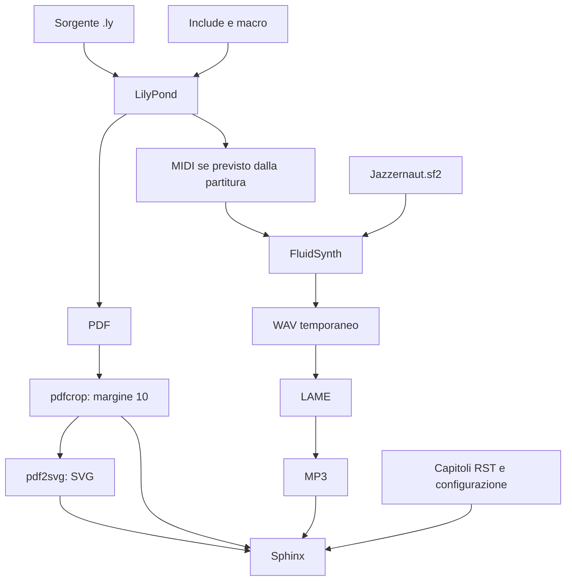

# Analisi della pipeline musicale

- Data: 2026-11-08
- Stato: analisi completata sul codice; raccomandazioni da decidere
- Ambito: appunti-pratica e appunti-teoria
- Metodo: lettura statica e inventario locale, senza esecuzione dei convertitori o modifica degli output.

## Problema e risultato atteso

Garantire che partiture e audio pubblicati corrispondano ai sorgenti e siano rigenerabili. Il criterio attuale basato sui timestamp copre solo una parte delle dipendenze. Il risultato atteso è un contratto esplicito degli output, con rilevamento dei cambiamenti, gestione dei fallimenti e controllo delle risorse pregresse.

## Evidenze e fonti

Fonti in ciascuna radice: `build-lilypond.sh`, `build.sh`, `.readthedocs.yaml`, `src/docs/conf.py`, `src/docs/*.rst`, `src/lilypond/**/*.ly`, inventario di `src/docs/_static/music` e `git ls-files`. I due script musicali esaminati hanno lo stesso contenuto. I numeri seguenti escludono le directory e includono file locali: presenza non significa validità o aggiornamento.

| Elemento | Pratica | Teoria |
|---|---:|---:|
| Sorgenti .ly al primo livello | 118 | 139 |
| PDF / SVG | 190 / 190 | 139 / 139 |
| MIDI / MP3 | 119 / 119 | 125 / 125 |
| PNG nella directory musicale | 0 | 3 |
| Sorgenti senza blocco MIDI esplicito | 11 | 19 |
| PDF senza sorgente omonimo al primo livello | 72 | 0 |

Tutti i sorgenti al primo livello hanno PDF e SVG omonimi; tutti quelli con blocco MIDI esplicito hanno il MIDI omonimo. Nei riferimenti `_static/music` estratti dai RST non sono emersi file mancanti: per le immagini wildcard questo significa almeno una corrispondenza, non disponibilità di tutti i formati.

Pratica dichiara LilyPond 2.24.4 in 103 sorgenti e 2.24.0 in 15. Teoria dichiara 2.24.4 in 136 e 2.26.0 nei tre `modulazione-diretta1/2/3.ly`. Sono versioni dichiarate nei file, non versioni installate o compatibilità provata.

## Flusso e dipendenze

Le frecce verso Sphinx indicano risorse disponibili: la selezione concreta dipende dal formato. L'audio è richiamato nei RST tramite HTML; questa analisi non ne certifica la resa in PDF/ePub.

Lo script va eseguito dalla radice: i percorsi sono relativi alla directory corrente. Cerca solo `.ly` al primo livello; `include/` contiene dipendenze, non unità compilate autonomamente. Gli include espliciti censiti sono `include/my-scales.ly` e `include/my-chart.ly` in Pratica, solo `include/my-chart.ly` in Teoria. La presenza di altre macro non ne prova l'utilizzo.

Dipendenze eseguibili: shell e utility di sistema, LilyPond, pdfcrop, pdf2svg, FluidSynth e LAME; soundfont leggibile in `src/lilypond/sf/Jazzernaut.sf2`. Lo script verifica prima dell'avvio solo LilyPond e directory sorgente. Le versioni degli strumenti, le opzioni e le dipendenze transitive dei convertitori contribuiscono al risultato, ma non sono registrate. Sphinx e Shibuya appartengono alla fase editoriale successiva.

## Regole attuali di aggiornamento

| Output | Condizione attuale | Dipendenze ignorate o casi scoperti |
|---|---|---|
| PDF e SVG | Uno manca oppure il `.ly` è più recente di uno dei due: si rigenera tutta la parte grafica | Include, strumenti, opzioni, contenuto con timestamp conservato |
| MIDI | Prodotto eventualmente da LilyPond durante la rigenerazione grafica | Un MIDI mancante da solo non provoca compilazione |
| MP3 | Manca oppure il MIDI è più recente | Soundfont, sintetizzatore, encoder e opzioni |
| WAV | Creato durante la conversione audio e rimosso dopo LAME | Dopo un errore può restare un intermedio |

Un MP3 mancante viene ricreato solo se esiste il MIDI da cui partire. Il secondo ciclo scorre tutti i MIDI presenti, anche quelli senza sorgente attuale. Rimuovere un `.ly` o il suo blocco MIDI non elimina i vecchi output. Cambiare un include può lasciare immagini e audio obsoleti senza alcun errore. I timestamp non dimostrano la provenienza degli output e possono cambiare dopo copie o checkout.

## Fallimenti e consistenza

`set -eu` interrompe normalmente il flusso al fallimento dei comandi, ma non offre rollback. I file vengono scritti direttamente nella destinazione definitiva; un errore fra compilazione, ritaglio e conversione può lasciare un insieme parziale. Se esistono già PDF e SVG con timestamp recenti, una successiva esecuzione può considerarli aggiornati senza sapere che la lavorazione precedente è fallita. Non vi sono manifest di successo, verifica dei file prodotti o protezione da esecuzioni concorrenti. Il ramo audio usa percorsi non quotati: il percorso corrente non contiene spazi, ma la gestione non è robusta per nomi futuri.

Non è esplicito il contratto per spartiti multipagina o con più score/output. Va verificato prima di assumere sempre un solo PDF, SVG e MIDI per nome base.

## Pubblicazione e patrimonio esistente

`build.sh` avvia solo Sphinx. `.readthedocs.yaml` non richiama la pipeline musicale né dichiara l'installazione dei relativi strumenti. Le risorse musicali sono già tracciate: 618 file in Pratica e 531 in Teoria. La pubblicazione configurata usa quindi le risorse disponibili nel checkout senza garantirne la rigenerazione musicale.

I 72 PDF di Pratica senza sorgente omonimo non sono automaticamente eliminabili: possono essere risorse pregresse ancora utilizzate o output con altra provenienza. In Teoria cinque MIDI hanno un sorgente omonimo senza blocco MIDI esplicito; in Pratica dodici MIDI non hanno sorgente omonimo. Sono anomalie di provenienza da classificare, non prova sufficiente di inutilità. Nessuna cancellazione proposta prima di confrontare utilizzi nei RST, eventuali output multipli e storia Git.

## Alternative

| Alternativa | Beneficio | Costo e limiti |
|---|---|---|
| A. Stato attuale con procedura manuale | Nessuna migrazione | Aggiornamento dipendente dall'operatore; debole rilevabilità degli errori |
| B. Rigenerazione completa controllata | Semplicità; copertura di include e soundfont per gli asset gestiti | Tempo da misurare; richiede comunque contratto output e ambiente noto; non ripristina sorgenti mancanti |
| C. Incrementale conservativo con firme | Riparte solo dove serve; riconosce cambiamenti di contenuto, strumenti e opzioni | Piccolo orchestratore e manifest da mantenere; complessità moderata |
| D. Grafo preciso con Make o altro motore | Dipendenze esplicite e riuso di un motore esistente | Include transitivi e output opzionali/multipli da modellare; nuovi strumenti e convenzioni |

Il motore di esecuzione e la strategia di invalidazione sono scelte distinte: Make da solo non risolve dipendenze non dichiarate. Centralizzare gli script fra repository è un'ulteriore decisione, non un prerequisito per correggere l'aggiornamento.

## Raccomandazione proposta

Adottare inizialmente B come riferimento di correttezza in una directory temporanea, misurandone durata e confrontandone gli output con quelli attuali. Per l'uso quotidiano preferire C solo se i tempi giustificano l'incrementale. Non introdurre subito un grafo preciso per singolo include.

Per C, una firma grafica deve comprendere sorgente, insieme conservativo degli include locali, versione degli strumenti e opzioni di compilazione/ritaglio/conversione. Una modifica a qualsiasi include può rigenerare tutte le partiture: è meno efficiente ma evita un parser parziale delle dipendenze. Il ramo audio deve dipendere da contenuto MIDI, soundfont, versioni e opzioni di FluidSynth/LAME. Gli output attesi mancanti o alterati devono invalidare il risultato, anche a firma degli input invariata. Il manifest registra successo e impronte degli output solo a lavorazione completata.

Definire esplicitamente quali sorgenti producono audio e quali asset sono esterni o pregressi. Usare una directory di preparazione per ciascuna unità e promuovere gli output solo dopo tutti i controlli; un manifest di completamento permette di riconoscere interruzioni durante la promozione. Evitare esecuzioni concorrenti sulla stessa destinazione. La pulizia deve riguardare solo output dichiarati come gestiti, con elenco preventivo consultabile.

Mantenere inizialmente gli asset tracciati e aggiungere un controllo prima della pubblicazione, conservando l'attuale flusso Read the Docs. Spostare la generazione musicale in CI richiede una decisione separata su ambiente, tempi e gestione degli artefatti. Le versioni dichiarate nei sorgenti richiedono una prova di compatibilità prima di scegliere la versione unica degli strumenti.

## Piano di verifica e criteri di accettazione

Da eseguire in una successiva implementazione autorizzata, su una copia o directory temporanea:

1. Compilazione completa di riferimento; conservare versioni, comandi, durata, errori e inventario. Verificare spartiti semplici, macro, casi senza audio e casi con più score/pagine.
2. Modifica di un `.ly`: aggiornamento dei suoi output previsti; modifica di un include: aggiornamento di tutte le unità coinvolte o dell'intero insieme conservativo.
3. Eliminazione di PDF, SVG, MIDI atteso o MP3: ricostruzione corretta di ciascuno. Un sorgente dichiarato senza audio non deve risultare in errore per MIDI assente.
4. Cambio soundfont o opzioni audio: nuovo MP3. Cambio tool/opzioni grafiche: nuova generazione grafica. Input modificato conservando timestamp: cambiamento rilevato con la strategia a firme.
5. Errore forzato di un convertitore: nessun nuovo stato dichiarato riuscito; rilancio capace di recuperare senza accettare output parziali. Seconda esecuzione invariata: nessuna conversione superflua con C.
6. Rimozione/rinomina di un sorgente e rimozione del MIDI dalla partitura: individuazione dei residui, senza cancellare asset esterni. Percorsi con spazi ed esecuzione concorrente gestiti esplicitamente.
7. Confronto visivo di PDF/SVG e ascolto di campioni MP3: note, durata, tempo, timbro e taglio. Controllo dei riferimenti nei RST e build Sphinx dei formati pubblicati.

Criterio finale: ogni risorsa gestita deve avere origine e dipendenze note, essere ricostruibile da input dichiarati e non essere dichiarata aggiornata dopo un fallimento. Riproducibilità non significa necessariamente identità binaria: metadati dei file possono differire; definire confronti adeguati al formato.

## Decisioni aperte e limiti

Da decidere: contratto degli output e patrimonio pregresso; versione supportata di LilyPond; strategia B/C dopo misurazione; luogo della generazione; successiva eventuale condivisione degli script. Questi temi potranno alimentare ADR distinti in stato Proposto.

Non sono state eseguite build, misure prestazionali, confronti visivi o audio, verifiche delle versioni installate o analisi completa della storia Git. Nessuna conclusione sulla correttezza musicale o sull'effettivo stato del sito remoto. L'analisi non autorizza implementazioni né rimozioni di risorse.

## Verifica successiva

Eseguita una prima compilazione isolata: vedere [misure e limiti](002-rigenerazione-controllata.md). Il limite iniziale relativo all’assenza di esecuzioni è superato solo per le fasi documentate in quel rapporto.
