Modern jazz e fusion
====================

.. _modern-percorso:

Dalle cadenze ai paesaggi sonori
--------------------------------

I capitoli :doc:`7-progressioni` e :doc:`8-licks` hanno messo in relazione
armonia e fraseggio bebop. Ora allarghiamo il campo: vamps, pedali,
strutture per quarte, sovrapposizioni, groove e organizzazioni ritmiche.
Modern jazz e fusion comprendono linguaggi diversi: questi strumenti
sono un percorso di studio, non una formula che li definisce tutti.

Il punto di partenza è sempre una frase riconoscibile. Da :ref:`lick-m01`
riprendiamo **Mi–Sol–Si**, aggiungendo Re: su Cmaj7 sono terza, quinta,
settima e nona; su Dm7 diventano nona, undicesima, tredicesima e tonica.
Cambia il significato delle stesse note. Negli studi 01 e 02 cambia poi
il ritmo, mentre il materiale rimane riconoscibile.

Per le ragioni armoniche leggi `Armonia non funzionale
<https://appunti-di-teoria-e-armonia-per-chitarra-jazz.readthedocs.io/it/latest/10-armonia-non-funzionale.html>`_;
per accenti, metri e cambi di pulsazione leggi `Ritmo e sviluppo del materiale
<https://appunti-di-teoria-e-armonia-per-chitarra-jazz.readthedocs.io/it/latest/12-ritmo-sviluppo.html>`_.

Come usare spartiti e basi
--------------------------

I **12 studi originali** hanno pentagramma e tablatura in accordatura
standard, una versione completa e una base. La base conserva accordi
lunghi, basso e batteria; toglie soltanto la parte di chitarra scritta.
Nello studio 03 quella parte è un accompagnamento ad accordi: usa la
base per suonarlo tu. I timbri sono sintetici, pensati come riferimento
per intonazione, incastri e forma.

Gli ottavi e i sedicesimi sono **regolari**, senza lo swing automatico
dei licks del capitolo precedente. Il tempo è 80 BPM, salvo il 7/8
(semiminima = 84) e la modulazione metrica (80 → 120). Una battuta di
conteggio precede ogni esempio: quattro quarti in 4/4, cinque in 5/4,
sette ottavi in 7/8. Il conteggio non appartiene allo spartito.
Gli audio eseguono la forma una volta; per ripeterli attendi la coda e
riparti dal conteggio. Non sovrapporre due lettori audio.

Prima canta la parte sulla versione completa, poi suonala sulla base.
La TAB propone una posizione: controlla i passaggi di corda e prova
altre diteggiature mantenendo altezza e durata. Per rallentare il lavoro
usa un metronomo prima della base, senza cambiare il raggruppamento.

Tre accompagnamenti da capire
-----------------------------

Gli spartiti seguenti mostrano **basso e batteria**, non la linea della
chitarra. Nella batteria le teste a croce in alto indicano il charleston;
il rullante è nello spazio centrale e la cassa nello spazio basso.
Nel 4/4 qui sotto il charleston articola i sedicesimi e il rullante marca
il secondo e il quarto movimento. Ascolta la cassa sincopata e le pause
del basso: la chitarra può lasciare spazio a questi incastri.

.. raw:: html

   <audio controls preload="none" aria-label="Groove in quattro quarti: basso e batteria">
     <source src="_static/music/modern-groove-44.mp3" type="audio/mpeg">
   </audio>

Nel **5/4** conta ``UNO due tre | QUATTRO cinque``: i due gruppi
occupano tre e due semiminime. La cassa segnala l'inizio dei gruppi.
Il rullante è sul terzo e sul quinto movimento: non cercare di imporre
il backbeat del precedente 4/4.

.. raw:: html

   <audio controls preload="none" aria-label="Groove in cinque quarti raggruppato tre più due">
     <source src="_static/music/modern-groove-54.mp3" type="audio/mpeg">
   </audio>

Nel **7/8** conta ``UNO due | TRE quattro | CINQUE sei sette``.
Sono gruppi di due, due e tre **crome**, non sette semiminime.
Basso e cassa aiutano a distinguere gli attacchi dei gruppi.

.. raw:: html

   <audio controls preload="none" aria-label="Groove in sette ottavi raggruppato due più due più tre">
     <source src="_static/music/modern-groove-78.mp3" type="audio/mpeg">
   </audio>

.. _modern-01:

01 — Dal bebop al vamp dorico
-----------------------------

La griglia alterna Dm7 ed Em7/D: una battuta per accordo. Il basso
mantiene Re come riferimento attraverso tonica, quinta e ottava; non
suona una nota tenuta. Em7/D introduce Mi–Sol–Si, mentre Dm7 rende udibile
il Fa naturale. Il Si naturale distingue il colore dorico dal minore naturale.

Canta Mi–Sol–Si–Re prima di suonare. Confronta l'inizio con :ref:`lick-m01`:
qui togliamo l'approccio cromatico e sviluppiamo il nucleo in un contesto
modale. Sulla base ripeti le prime tre note, poi inventa una risposta che
termini su Re o Fa. Riconosci il centro anche quando l'accordo superiore cambia.

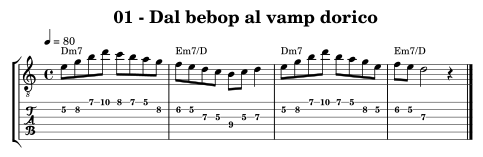

.. raw:: html

   <audio controls preload="none" aria-label="01 — Dal bebop al vamp dorico">
     <source src="_static/music/modern-01.mp3" type="audio/mpeg">
   </audio>

**Base senza la parte di chitarra dello spartito**:

.. raw:: html

   <audio controls preload="none" aria-label="Base di accompagnamento modern-01">
     <source src="_static/music/modern-01-base.mp3" type="audio/mpeg">
   </audio>

.. _modern-02:

02 — La stessa cellula nel groove
---------------------------------

La griglia ora rimane su Dm7 per quattro battute. Riprendiamo il nucleo
Mi–Sol–Si–Re dello studio 01 e introduciamo sedicesimi, pause e partenze
fra i movimenti. Non basta aumentare la velocità: ascolta dove ciascun
attacco cade rispetto a cassa e rullante.

Conta ad alta voce i quattro movimenti, poi suddividili in quattro parti.
Suona inizialmente tutto con pennate leggere; scegli poi due accenti per
battuta senza accentare ogni nota. Prova legato e pennata alternata sulla
stessa linea. L'audio verifica altezze e durate: la scelta del gesto e del
timbro rimane parte dello studio.

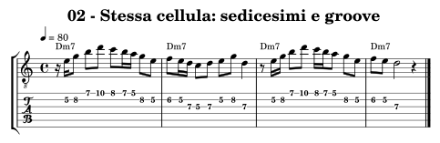

.. raw:: html

   <audio controls preload="none" aria-label="02 — La stessa cellula nel groove">
     <source src="_static/music/modern-02.mp3" type="audio/mpeg">
   </audio>

**Base senza la parte di chitarra dello spartito**:

.. raw:: html

   <audio controls preload="none" aria-label="Base di accompagnamento modern-02">
     <source src="_static/music/modern-02-base.mp3" type="audio/mpeg">
   </audio>

.. _modern-03:

03 — Quarte sopra il pedale
---------------------------

I voicing sono **Re–Sol–Do–Fa** e **Re–La–Re–Sol**, sulle corde
5–4–3–2. Su Re al basso il primo contiene tonica, undicesima, settima
minore e terza minore; il secondo tonica, quinta, tonica e undicesima.
Il secondo non contiene la terza: è il contesto a mantenere il colore minore.

Sono strutture di quattro note, distinte dagli :ref:`shell-voicings` a
sole tre voci sulle corde 6–4–3 o 5–4–3. Il loro basso alla chitarra è
sempre Re, come il basso d'insieme. Fai sentire ogni voce e sposta
le tre voci superiori senza trascinare rumori. Poi riduci gli accordi a due
attacchi per battuta e lascia rispondere la batteria.

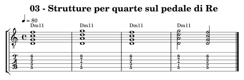

.. raw:: html

   <audio controls preload="none" aria-label="03 — Quarte sopra il pedale">
     <source src="_static/music/modern-03.mp3" type="audio/mpeg">
   </audio>

**Base senza la parte di chitarra dello spartito**:

.. raw:: html

   <audio controls preload="none" aria-label="Base di accompagnamento modern-03">
     <source src="_static/music/modern-03-base.mp3" type="audio/mpeg">
   </audio>

.. _modern-04:

04 — Una triade come struttura superiore
----------------------------------------

Su Cmaj7 suoniamo la triade di **Re maggiore: Re–Fa♯–La**, cioè
9–♯11–13 rispetto a Do. L'accompagnamento fornisce Do–Mi–Si;
la melodia completa le tensioni. Nella terza battuta la triade è arpeggiata in semiminime,
mentre il basso resta Do: la chitarra esegue una linea, non un voicing
con una tensione al basso.

Suona prima soltanto Re–Fa♯–La e poi risolvi sul Mi. Il Fa♯ non rende
necessariamente lidio un intero brano: stiamo prolungando una sonorità
specifica. Controlla anche la diversa sensazione di Fa naturale e Fa♯
prima di scegliere la tensione.

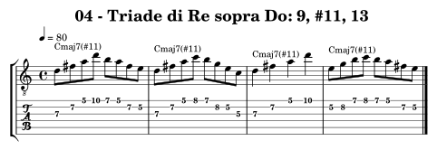

.. raw:: html

   <audio controls preload="none" aria-label="04 — Una triade come struttura superiore">
     <source src="_static/music/modern-04.mp3" type="audio/mpeg">
   </audio>

**Base senza la parte di chitarra dello spartito**:

.. raw:: html

   <audio controls preload="none" aria-label="Base di accompagnamento modern-04">
     <source src="_static/music/modern-04-base.mp3" type="audio/mpeg">
   </audio>

.. _modern-05:

05 — Pentatonica sovrapposta
----------------------------

La pentatonica di **Mi minore** contiene Mi–Sol–La–Si–Re.
Su Dm7 produce 9–11–5–13–1. Il Fa nell'accompagnamento sostiene
la terza minore, assente nella pentatonica; il Si della linea rende
riconoscibile la sesta maggiore dorica.

Suona la pentatonica in una posizione e canta il grado di ogni nota
rispetto a Re. Costruisci poi due battute con sole tre note, mantenendo
le pause della frase originale. La sovrapposizione deve avere una direzione,
non diventare una diteggiatura eseguita automaticamente.

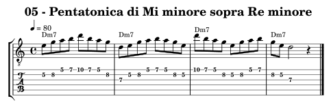

.. raw:: html

   <audio controls preload="none" aria-label="05 — Pentatonica sovrapposta">
     <source src="_static/music/modern-05.mp3" type="audio/mpeg">
   </audio>

**Base senza la parte di chitarra dello spartito**:

.. raw:: html

   <audio controls preload="none" aria-label="Base di accompagnamento modern-05">
     <source src="_static/music/modern-05-base.mp3" type="audio/mpeg">
   </audio>

.. _modern-06:

06 — Side-slip e ritorno
------------------------

La prima battuta usa Mi minore pentatonico su Dm7. Nella seconda metà
della seconda battuta la cellula si sposta di un semitono: **Fa–La♭–Si♭–Do**,
un frammento di Fa minore pentatonico. La terza battuta torna a Mi–Sol–La–Si.
Fa e Do appartengono anche a Re dorico: non tutte le note del frammento
sono esterne. La tensione nasce soprattutto da La♭ e Si♭ e dal disegno parallelo.

Isola le battute 2–3. Canta il rientro sul Mi prima di suonare la parte
esterna. Poi riduci l'uscita a due note e torna su Fa o Re. Perdere la
forma non è un effetto outside: mantieni il conteggio durante l'intera frase.

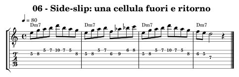

.. raw:: html

   <audio controls preload="none" aria-label="06 — Side-slip e ritorno">
     <source src="_static/music/modern-06.mp3" type="audio/mpeg">
   </audio>

**Base senza la parte di chitarra dello spartito**:

.. raw:: html

   <audio controls preload="none" aria-label="Base di accompagnamento modern-06">
     <source src="_static/music/modern-06-base.mp3" type="audio/mpeg">
   </audio>

.. _modern-07:

07 — Accenti ogni tre crome
---------------------------

Mi–Sol–Si si ripete senza ricominciare sul primo movimento di ogni
battuta. Gli accenti scritti ogni tre crome attraversano tre battute di
4/4: 24 crome ospitano otto cellule. Nella quarta battuta la linea si
ferma su Re e ritrova chiaramente l'inizio della misura.

La batteria mantiene il 4/4: non cambiamo metro. Batti i quarti con il
piede e canta soltanto le note accentate; aggiungi poi le altre più piano.
Confronta questo ciclo continuo con un 3+3+2 che ricomincia ogni battuta:
la distribuzione degli accenti è diversa.

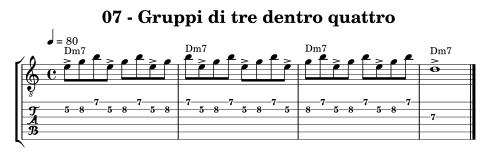

.. raw:: html

   <audio controls preload="none" aria-label="07 — Accenti ogni tre crome">
     <source src="_static/music/modern-07.mp3" type="audio/mpeg">
   </audio>

**Base senza la parte di chitarra dello spartito**:

.. raw:: html

   <audio controls preload="none" aria-label="Base di accompagnamento modern-07">
     <source src="_static/music/modern-07-base.mp3" type="audio/mpeg">
   </audio>

.. _modern-08:

08 — Cinque quarti: 3 + 2
-------------------------

Ogni battuta contiene dieci crome, raggruppate in sei più quattro.
Conta cinque quarti, organizzati **3 + 2**; non aggiungere una pausa
in fondo a una frase pensata in 4/4. Ascolta la partenza del secondo
gruppo sul quarto movimento.

Suona prima cinque fondamentali per battuta, poi i primi tre movimenti
della linea e una risposta di due. Trasporta soltanto quando riesci a
cantare quattro battute senza perdere il ritorno al primo movimento.

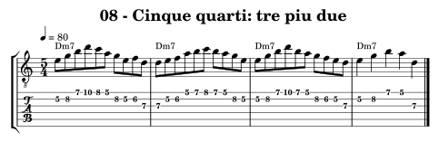

.. raw:: html

   <audio controls preload="none" aria-label="08 — Cinque quarti: 3 + 2">
     <source src="_static/music/modern-08.mp3" type="audio/mpeg">
   </audio>

**Base senza la parte di chitarra dello spartito**:

.. raw:: html

   <audio controls preload="none" aria-label="Base di accompagnamento modern-08">
     <source src="_static/music/modern-08-base.mp3" type="audio/mpeg">
   </audio>

.. _modern-09:

09 — Sette ottavi: 2 + 2 + 3
----------------------------

Ogni battuta contiene sette crome. La semiminima indicata a 84 è
il riferimento del tempo; le crome scorrono a 168 al minuto. Il conteggio
iniziale ha sette colpi di croma e prepara una battuta di 2+2+3.

Batti le mani sui tre inizi dei gruppi e canta tutte le sette suddivisioni.
Poi suona la linea senza accelerare il gruppo finale di tre. Nell'ultima
battuta le durate attraversano il raggruppamento: mantieni il conteggio
anche quando una nota prosegue oltre un accento del groove.

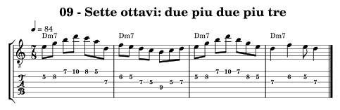

.. raw:: html

   <audio controls preload="none" aria-label="09 — Sette ottavi: 2 + 2 + 3">
     <source src="_static/music/modern-09.mp3" type="audio/mpeg">
   </audio>

**Base senza la parte di chitarra dello spartito**:

.. raw:: html

   <audio controls preload="none" aria-label="Base di accompagnamento modern-09">
     <source src="_static/music/modern-09-base.mp3" type="audio/mpeg">
   </audio>

.. _modern-10:

10 — La terzina diventa pulsazione
----------------------------------

Le prime due battute sono in 4/4 a **80 BPM** con terzine di
semiminime: sei attacchi equidistanti per battuta. Nelle ultime due,
la semiminima passa a **120 BPM**. La vecchia semiminima in terzina
ha la stessa durata della nuova semiminima: 0,5 secondi.

Il flusso della melodia continua alla stessa distanza fra gli attacchi,
mentre cambia il modo di contarli; il basso e la batteria adottano la
nuova pulsazione al terzo inizio di battuta. Non sono sestine dentro un
solo movimento e non è un'accelerazione graduale. Canta sei impulsi nelle
prime due battute, poi quattro nelle successive, mantenendoli equidistanti.

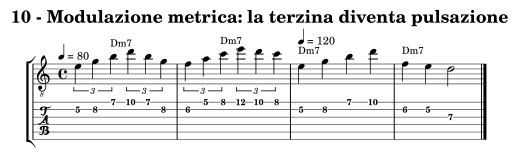

.. raw:: html

   <audio controls preload="none" aria-label="10 — La terzina diventa pulsazione">
     <source src="_static/music/modern-10.mp3" type="audio/mpeg">
   </audio>

**Base senza la parte di chitarra dello spartito**:

.. raw:: html

   <audio controls preload="none" aria-label="Base di accompagnamento modern-10">
     <source src="_static/music/modern-10-base.mp3" type="audio/mpeg">
   </audio>

.. _modern-11:

11 — Studio fusion di otto battute
----------------------------------

La forma è **Dm7, Dm7, Em7/D, Em7/D, Dm7, Dm7, Em7/D, Dm7**.
La linea combina il nucleo iniziale, le sincopi e una breve uscita:
nell'ultimo movimento della sesta battuta compaiono Fa–La♭–Si♭–Mi♭;
la settima rientra su Mi–Sol–Si–Re. Il Fa resta interno, mentre le altre
note creano la tensione che il rientro chiarisce.

Memorizza la forma in quattro coppie di battute. Sulla base suona prima
soltanto l'inizio di ogni coppia; aggiungi le risposte e infine l'uscita.
Registra un secondo giro cambiando soltanto il ritmo, poi un terzo
cambiando soltanto il finale. Conserva almeno un tratto riconoscibile.

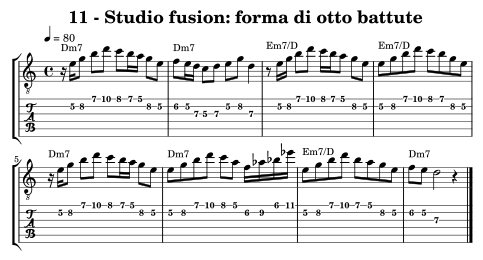

.. raw:: html

   <audio controls preload="none" aria-label="11 — Studio fusion di otto battute">
     <source src="_static/music/modern-11.mp3" type="audio/mpeg">
   </audio>

**Base senza la parte di chitarra dello spartito**:

.. raw:: html

   <audio controls preload="none" aria-label="Base di accompagnamento modern-11">
     <source src="_static/music/modern-11-base.mp3" type="audio/mpeg">
   </audio>

.. _modern-12:

12 — La stessa relazione su quattro centri
------------------------------------------

Le quattro sonorità durano una battuta ciascuna: Cmaj7(♯11),
E♭maj7(♯11), A♭maj7(♯11), D♭maj7(♯11). Sopra ciascuna riproponiamo
una triade maggiore **un tono sopra la fondamentale**: Re, Fa, Si♭, Mi♭.
Le rispettive triadi danno sempre 9–♯11–13; le note successive della
linea collegano la tensione alla terza o ad altre note dell'accordo.

Questo movimento conserva una relazione interna fra accordo e materiale
melodico. Quattro accordi diversi non dimostrano da soli quattro
modulazioni: ascolta se un centro viene davvero stabilito. Collega lo
studio a :ref:`progressioni-centri`, poi sostituisci due accordi conservando
la relazione della triade superiore.

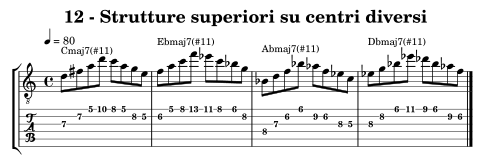

.. raw:: html

   <audio controls preload="none" aria-label="12 — La stessa relazione su quattro centri">
     <source src="_static/music/modern-12.mp3" type="audio/mpeg">
   </audio>

**Base senza la parte di chitarra dello spartito**:

.. raw:: html

   <audio controls preload="none" aria-label="Base di accompagnamento modern-12">
     <source src="_static/music/modern-12-base.mp3" type="audio/mpeg">
   </audio>

Costruire uno studio personale
------------------------------

Scegli una griglia di :doc:`7-progressioni` o un vamp di questo capitolo.
Prendi tre note da un lick di :doc:`8-licks` e scrivine i gradi rispetto
al nuovo basso. Mantieni quelle note e crea quattro versioni: ritmo
regolare, pause e sincopi, accenti spostati, breve tensione con rientro.
Cambia un elemento alla volta e registra otto battute per versione.

Valuta se il centro resta udibile, se riconosci la cellula, se il groove
continua durante le pause e se la tensione trova una destinazione.
Solo dopo aggiungi densità o velocità. Un risultato convincente può
usare poche note e lasciare molto spazio alla sezione ritmica.
