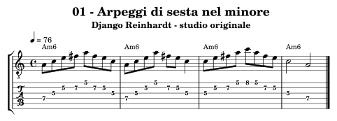
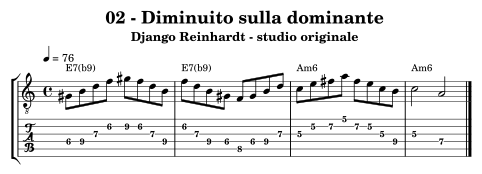
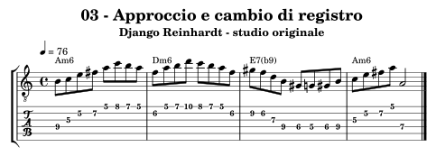
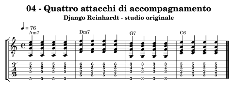
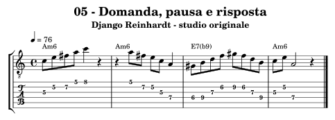
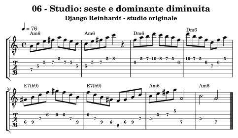

.. _autore-django:

Django Reinhardt
================

Il percorso entra nel linguaggio di Django attraverso il rapporto fra accordo, gesto ritmico e invenzione melodica. Le seste nel minore, le dominanti diminuite e i cambi di registro offrono punti di ascolto precisi. L’accompagnamento richiede un lavoro specifico di attacco e rilascio: leggere quattro accordi non equivale ancora a suonare la pompe. Sono strumenti da confrontare con registrazioni diverse, non una descrizione di tutta la sua produzione.

Obiettivi e prerequisiti
------------------------

**Obiettivo:** Arpeggi, seste, diminuiti e accompagnamento swing.

Riprendi :doc:`Arpeggi <../5-arpeggi>`, :doc:`Accordi <../6-accordi>`, :doc:`Progressioni <../7-progressioni>`. Per l’analisi consulta `il percorso in Teoria <https://appunti-di-teoria-e-armonia-per-chitarra-jazz.readthedocs.io/it/latest/13-percorsi-autore.html#autore-django>`_.

Ascolti guidati
---------------

**Minor Swing — versione nella raccolta Djangology di Legacy**

Segui prima gli accompagnatori e conta i quattro movimenti; al secondo ascolto cerca un punto in cui l’arpeggio si interrompe e lascia spazio alla risposta. Canta il profilo senza cercare subito tutti i tasti.

**Djangology — stessa raccolta**

Confronta l’esposizione del tema e un tratto del solo. Segna un salto di registro e un collegamento cromatico, poi descrivi come cambiano densità e intensità.

Fonti e accesso agli ascolti: `Djangology, catalogo e tracce Legacy <https://www.legacyrecordings.com/releases/djangology/>`_.

Che cosa osservare
------------------

Nell’esercizio 02 Sol♯–Si–Re–Fa, sopra Mi, diventa 3–5–♭7–♭9. Il gruppo diminuito non coincide con la fondamentale della dominante; l’arrivo su Do nella terza battuta chiarisce Am6. Il Fa♯ degli esempi in Am6 è invece sesta maggiore della tonica minore: distinguere i due Fa impedisce di usare un’unica scala indifferenziata.

**Confronto:** Suona l’arpeggio di Am e aggiungi prima Fa naturale, poi Fa♯. Ascolta il cambiamento sopra Am6; poi sposta Fa naturale sulla dominante E7(♭9), dove assume un’altra relazione.

.. _autore-django-01:

01 — Arpeggi di sesta nel minore
--------------------------------

**4 battute in 4/4; semiminima = 76; crome swing 2:1.** Una sigla per battuta.

**Griglia:** ``| Am6 | Am6 | Am6 | Am6 |``.

La–Do–Mi–Fa♯ mette in evidenza Am6: tonica, terza minore, quinta e sesta maggiore. I salti disegnano l’accordo senza riempire ogni spazio con una scala.

**Al lavoro:** Canta il Fa♯ prima della salita. Ripeti la seconda battuta con due diteggiature e conserva la durata delle note; poi cambia soltanto l’ultima risposta.

.. raw:: html

   <audio controls preload="none" aria-label="Django Reinhardt, esempio originale 01">
     <source src="../_static/music/autori-django-01.mp3" type="audio/mpeg">
   </audio>

.. _autore-django-02:

02 — Diminuito sulla dominante
------------------------------

**4 battute in 4/4; semiminima = 76; crome swing 2:1.** Una sigla per battuta.

**Griglia:** ``| E7(b9) | E7(b9) | Am6 | Am6 |``.

Sol♯–Si–Re–Fa è il diminuito costruito dalla terza di E7: 3–5–♭7–♭9. Il Do della terza battuta chiarisce l’arrivo su La minore.

**Al lavoro:** Isola l’ultima nota di E7 e la prima di Am6: Re → Do. Trasporta il diminuito per terze minori e controlla quali note restano le stesse.

.. raw:: html

   <audio controls preload="none" aria-label="Django Reinhardt, esempio originale 02">
     <source src="../_static/music/autori-django-02.mp3" type="audio/mpeg">
   </audio>

.. _autore-django-03:

03 — Approccio e cambio di registro
-----------------------------------

**4 battute in 4/4; semiminima = 76; crome swing 2:1.** Una sigla per battuta.

**Griglia:** ``| Am6 | Dm6 | E7(b9) | Am6 |``.

Si prepara Do all’inizio; Sol–Sol♯ riprende la terza della dominante. Gli arpeggi vengono collegati da pochi semitoni mirati.

**Al lavoro:** Suona prima solo l’inizio di ogni battuta. Aggiungi i collegamenti senza accentare automaticamente ogni cambio di corda.

.. raw:: html

   <audio controls preload="none" aria-label="Django Reinhardt, esempio originale 03">
     <source src="../_static/music/autori-django-03.mp3" type="audio/mpeg">
   </audio>

.. _autore-django-04:

04 — Quattro attacchi di accompagnamento
----------------------------------------

**4 battute in 4/4; semiminima = 76; crome swing 2:1.** Una sigla per battuta.

**Griglia:** ``| Am7 | Dm7 | G7 | C6 |``.

Quattro accordi per battuta separano il lavoro della mano ritmica dalle linee solistiche. Sono voicing completi di quattro note con fondamentale al basso, non shell.

**Al lavoro:** Studia una durata breve e un rilascio coordinato delle dita, con secondo e quarto movimento leggermente in rilievo. L’audio tiene il valore scritto: il rilascio per la pompe è un lavoro manuale da confrontare con l’ascolto.

.. raw:: html

   <audio controls preload="none" aria-label="Django Reinhardt, esempio originale 04">
     <source src="../_static/music/autori-django-04.mp3" type="audio/mpeg">
   </audio>

.. _autore-django-05:

05 — Domanda, pausa e risposta
------------------------------

**4 battute in 4/4; semiminima = 76; crome swing 2:1.** Una sigla per battuta.

**Griglia:** ``| Am6 | Am6 | E7(b9) | Am6 |``.

Il silenzio separa due registri prima della salita diminuita. La forma della frase conta quanto la velocità dell’arpeggio.

**Al lavoro:** Canta entrambe le frasi senza toccare lo strumento. Conserva le pause e inventa una risposta più corta.

.. raw:: html

   <audio controls preload="none" aria-label="Django Reinhardt, esempio originale 05">
     <source src="../_static/music/autori-django-05.mp3" type="audio/mpeg">
   </audio>

.. _autore-django-06:

06 — Studio: seste e dominante diminuita
----------------------------------------

**8 battute in 4/4; semiminima = 76; crome swing 2:1.** Una sigla per battuta.

**Griglia:** ``| Am6 | Am6 | Dm6 | Dm6 | E7(b9) | E7(b9) | Am6 | Am6 |``.

Otto battute originali: due di Am6, due di Dm6, due di E7(♭9), due di Am6. Il Fa♯ caratterizza il primo minore e il Si naturale la sesta di Dm6; Fa naturale appartiene alla dominante alterata.

**Al lavoro:** Sulla base alterna un giro scritto e un giro con risposte tue. Conserva l’arrivo su Do nella settima battuta e il riposo finale su La.

.. raw:: html

   <audio controls preload="none" aria-label="Django Reinhardt, esempio originale 06">
     <source src="../_static/music/autori-django-06.mp3" type="audio/mpeg">
   </audio>

**Base senza la chitarra scritta:**

.. raw:: html

   <audio controls preload="none" aria-label="Base dello studio conclusivo, percorso Django Reinhardt">
     <source src="../_static/music/autori-django-06-base.mp3" type="audio/mpeg">
   </audio>

Autovalutazione e approfondimento
---------------------------------

Riesci a far sentire la sesta maggiore nel minore, a risolvere la dominante e a mantenere quattro attacchi regolari senza irrigidire la mano?

Confronta il tuo accompagnamento con la registrazione: scegli un solo aspetto da correggere, durata degli accordi oppure rilievo di secondo e quarto movimento. Per la mano solistica studia le pennate in appoggio lentamente, senza imporre una diteggiatura biografica o limitare artificialmente le dita.

Per passare a un altro linguaggio, torna a :doc:`../10-percorsi-autore` e
scegli un percorso che cambi una sola dimensione del tuo studio attuale.
