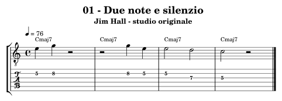
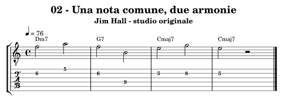
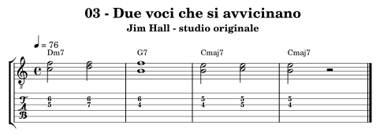
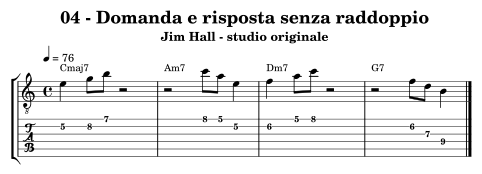
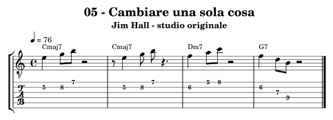
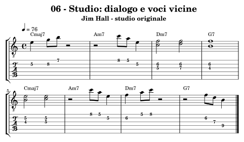

.. _autore-hall:

Jim Hall
========

Il lavoro riguarda la scelta di quando intervenire e quali voci mettere in relazione. Una cellula breve può svilupparsi attraverso silenzio, spostamento e risposta; le coppie di note possono far sentire un accordo senza riempire tutto il registro. L’ascolto in duo aiuta a distinguere iniziativa, sostegno e dialogo: il compito non è riprodurre ogni accordo che si conosce.

Obiettivi e prerequisiti
------------------------

**Obiettivo:** Spazio, motivi, dialogo e movimento delle voci.

Riprendi :doc:`Accordi <../6-accordi>`, :doc:`Progressioni <../7-progressioni>`, :doc:`Modern jazz e fusion <../9-modern-jazz-fusion>`. Per l’analisi consulta `il percorso in Teoria <https://appunti-di-teoria-e-armonia-per-chitarra-jazz.readthedocs.io/it/latest/13-percorsi-autore.html#autore-hall>`_.

Ascolti guidati
---------------

**My Funny Valentine — Bill Evans e Jim Hall, Undercurrent; versione principale, non la take alternativa**

Ascolta una volta seguendo solo il pianoforte e una volta solo la chitarra. Scegli un punto in cui una parte lascia spazio e descrivi che cosa fa l’altra.

**Romain — stesso album, versione principale**

Cerca una cellula che ritorna e una risposta che la modifica. Segna pause e cambi di densità prima di analizzare le sigle.

Fonti e accesso agli ascolti: `Jim Hall, profilo Blue Note <https://www.bluenote.com/artist/jim-hall/>`_, `Jim Hall, archivio ufficiale <https://www.jimhallmusic.com/>`_.

Che cosa osservare
------------------

Nell’esercizio 03 Do–Fa e Re–Fa arrivano a Si–Fa sopra G7; poi il Fa scende a Mi e il Si resta fermo su Cmaj7. Il collegamento descrive una risoluzione con un movimento minimo. Nell’esercizio 05 la cellula viene spostata di una croma: la pausa finale si accorcia per conservare la misura.

**Confronto:** Canta la voce alta e suona la bassa, poi inverti i ruoli. Nella frase ritmica mantieni le note uguali e sposta soltanto l’inizio: valuta se resta riconoscibile.

.. _autore-hall-01:

01 — Due note e silenzio
------------------------

**4 battute in 4/4; semiminima = 76; crome swing 2:1.** Una sigla per battuta.

**Griglia:** ``| Cmaj7 | Cmaj7 | Cmaj7 | Cmaj7 |``.

Mi–Sol viene proposto, lasciato risuonare e ripreso in ordine inverso. L’assenza di note occupa una durata precisa nella forma.

**Al lavoro:** Conta tutta la pausa senza aggiungere riempitivi. Canta la risposta prima di suonarla, poi cambia soltanto l’ultima altezza.

.. raw:: html

   <audio controls preload="none" aria-label="Jim Hall, esempio originale 01">
     <source src="../_static/music/autori-hall-01.mp3" type="audio/mpeg">
   </audio>

.. _autore-hall-02:

02 — Una nota comune, due armonie
---------------------------------

**4 battute in 4/4; semiminima = 76; crome swing 2:1.** Una sigla per battuta.

**Griglia:** ``| Dm7 | G7 | Cmaj7 | Cmaj7 |``.

Il Fa rimane fra Dm7 e G7 cambiando funzione da terza a settima; Si conduce al Mi, terza di Cmaj7.

**Al lavoro:** Ascolta l’accordo mentre tieni il Fa, senza ripeterlo come automatismo. Poi inventa un’altra risposta che termini su Mi.

.. raw:: html

   <audio controls preload="none" aria-label="Jim Hall, esempio originale 02">
     <source src="../_static/music/autori-hall-02.mp3" type="audio/mpeg">
   </audio>

.. _autore-hall-03:

03 — Due voci che si avvicinano
-------------------------------

**4 battute in 4/4; semiminima = 76; crome swing 2:1.** Una sigla per battuta.

**Griglia:** ``| Dm7 | G7 | Cmaj7 | Cmaj7 |``.

Le coppie Do–Fa e Re–Fa arrivano a Si–Fa su G7 e a Si–Mi su Cmaj7. Una voce resta ferma mentre l’altra si muove.

**Al lavoro:** Canta prima la voce superiore, poi quella inferiore. Queste coppie non sono shell: il basso della base completa il contesto armonico.

.. raw:: html

   <audio controls preload="none" aria-label="Jim Hall, esempio originale 03">
     <source src="../_static/music/autori-hall-03.mp3" type="audio/mpeg">
   </audio>

.. _autore-hall-04:

04 — Domanda e risposta senza raddoppio
---------------------------------------

**4 battute in 4/4; semiminima = 76; crome swing 2:1.** Una sigla per battuta.

**Griglia:** ``| Cmaj7 | Am7 | Dm7 | G7 |``.

Le battute dispari parlano nella prima metà; le pari rispondono nella seconda. Il dialogo nasce dall’alternanza, non da due linee sovrapposte.

**Al lavoro:** Con un compagno dividete le battute dispari e pari. Da solo canta una parte e suona l’altra, mantenendo le pause assegnate.

.. raw:: html

   <audio controls preload="none" aria-label="Jim Hall, esempio originale 04">
     <source src="../_static/music/autori-hall-04.mp3" type="audio/mpeg">
   </audio>

.. _autore-hall-05:

05 — Cambiare una sola cosa
---------------------------

**4 battute in 4/4; semiminima = 76; crome swing 2:1.** Una sigla per battuta.

**Griglia:** ``| Cmaj7 | Cmaj7 | Dm7 | G7 |``.

La seconda battuta sposta il motivo di una croma senza cambiarne altezze e durate interne; la pausa conclusiva si accorcia per rispettare il 4/4.

**Al lavoro:** Confronta le prime due battute sul metronomo. Mantieni riconoscibile il motivo anche quando la sua partenza si sposta.

.. raw:: html

   <audio controls preload="none" aria-label="Jim Hall, esempio originale 05">
     <source src="../_static/music/autori-hall-05.mp3" type="audio/mpeg">
   </audio>

.. _autore-hall-06:

06 — Studio: dialogo e voci vicine
----------------------------------

**8 battute in 4/4; semiminima = 76; crome swing 2:1.** Una sigla per battuta.

**Griglia:** ``| Cmaj7 | Am7 | Dm7 | G7 | Cmaj7 | Am7 | Dm7 | G7 |``.

Otto battute alternano linea, coppie di note e silenzio. Il turnaround finale rimane aperto e prepara Cmaj7 al giro successivo.

**Al lavoro:** Sulla base dimezza gli attacchi senza cambiare la forma. Registra e ascolta se il silenzio prepara davvero la risposta invece di interrompere il discorso.

.. raw:: html

   <audio controls preload="none" aria-label="Jim Hall, esempio originale 06">
     <source src="../_static/music/autori-hall-06.mp3" type="audio/mpeg">
   </audio>

**Base senza la chitarra scritta:**

.. raw:: html

   <audio controls preload="none" aria-label="Base dello studio conclusivo, percorso Jim Hall">
     <source src="../_static/music/autori-hall-06-base.mp3" type="audio/mpeg">
   </audio>

Autovalutazione e approfondimento
---------------------------------

Sai contare le pause e cantare entrambe le voci? Le risposte continuano ciò che precede, invece di aggiungere materiale senza relazione?

Suona in duo distribuendo una frase a testa. Nel secondo tentativo chi accompagna usa al massimo due note per attacco; riascoltate se emerge un dialogo o una semplice alternanza.

Per passare a un altro linguaggio, torna a :doc:`../10-percorsi-autore` e
scegli un percorso che cambi una sola dimensione del tuo studio attuale.
