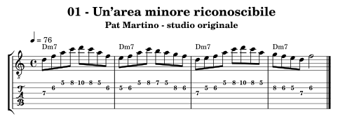
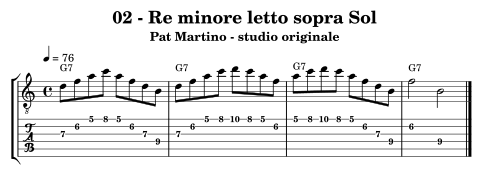
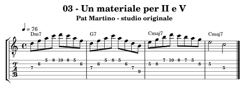
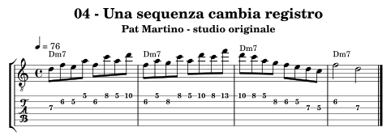
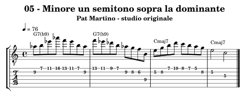
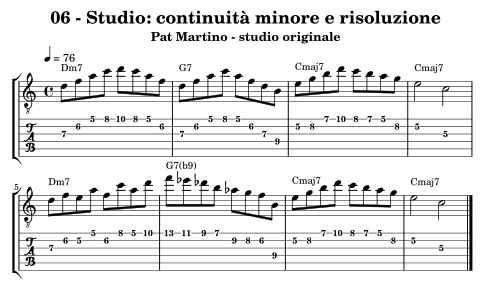

.. _autore-martino:

Pat Martino
===========

Organizziamo la linea intorno a un’area minore riconoscibile e osserviamo come cambia significato sopra accordi diversi. La continuità delle crome richiede controllo del percorso e dei bersagli, non soltanto velocità. Le conversioni qui sono esempi circoscritti e verificati nota per nota; il materiale didattico di Martino approfondisce un sistema più ampio, che non viene ridotto a una formula universale.

Obiettivi e prerequisiti
------------------------

**Obiettivo:** Aree minori, continuità e rilettura delle dominanti.

Riprendi :doc:`Scale <../4-scale>`, :doc:`Arpeggi <../5-arpeggi>`, :doc:`Progressioni <../7-progressioni>`, :doc:`Licks <../8-licks>`. Per l’analisi consulta `il percorso in Teoria <https://appunti-di-teoria-e-armonia-per-chitarra-jazz.readthedocs.io/it/latest/13-percorsi-autore.html#autore-martino>`_.

Ascolti guidati
---------------

**Just Friends — Pat Martino, El Hombre**

Segui una frase attraverso il cambio di accordo. Canta le sue note di arrivo e osserva se il disegno mantiene continuità pur cambiando funzione.

**Waltz for Guito — stesso album**

Conta la pulsazione ternaria e confronta le lunghezze delle frasi con Just Friends. Il metro dell’ascolto non è quello dei nostri esercizi, scritti in 4/4.

Fonti e accesso agli ascolti: `El Hombre, Concord <https://concord.com/concord-albums/el-hombre/>`_, `The Nature of Guitar, lezioni di Pat Martino su TrueFire <https://truefire.com/courses/pat-martino/the-nature-of-guitar/c1002>`_.

Che cosa osservare
------------------

Nell’esercizio 02 Re–Fa–La–Do sopra G7 dà 5–♭7–9–11 e non contiene il Si, terza della dominante. Il Si aggiunto chiarisce quella qualità prima del Mi sul I. Nell’esercizio 05 la triade di La♭ minore dà ♭9–3 enarmonica–♭13 su G7: è un colore diverso, da risolvere, non l’equivalenza letterale di due accordi.

**Confronto:** Suona Dm7 prima su basso Re e poi su basso Sol. Mantieni le altezze e ricalcola i gradi; aggiungi Si e ascolta che cosa rende udibile la dominante. Confronta poi La♭–Si–Mi♭, senza mescolare le due scelte automaticamente.

.. _autore-martino-01:

01 — Un’area minore riconoscibile
---------------------------------

**4 battute in 4/4; semiminima = 76; crome swing 2:1.** Una sigla per battuta.

**Griglia:** ``| Dm7 | Dm7 | Dm7 | Dm7 |``.

Re–Fa–La–Do organizza l’area di Dm7; Mi e Si la ampliano nel dorico. Si parte da una sonorità conosciuta, non da un’etichetta diversa per ogni nota.

**Al lavoro:** Suona le prime quattro note in due zone della tastiera. Conserva gli intervalli e scegli un punto di arrivo prima di sviluppare la linea.

.. raw:: html

   <audio controls preload="none" aria-label="Pat Martino, esempio originale 01">
     <source src="../_static/music/autori-martino-01.mp3" type="audio/mpeg">
   </audio>

.. _autore-martino-02:

02 — Re minore letto sopra Sol
------------------------------

**4 battute in 4/4; semiminima = 76; crome swing 2:1.** Una sigla per battuta.

**Griglia:** ``| G7 | G7 | G7 | G7 |``.

L’arpeggio Dm7 su G7 dà 5–♭7–9–11. Il Si conclusivo rende esplicita la terza della dominante, assente dall’arpeggio minore.

**Al lavoro:** Canta i gradi rispetto a Sol. Tieni brevi i Do quando vuoi un colore di dominante definito e confronta l’arrivo su Si.

.. raw:: html

   <audio controls preload="none" aria-label="Pat Martino, esempio originale 02">
     <source src="../_static/music/autori-martino-02.mp3" type="audio/mpeg">
   </audio>

.. _autore-martino-03:

03 — Un materiale per II e V
----------------------------

**4 battute in 4/4; semiminima = 76; crome swing 2:1.** Una sigla per battuta.

**Griglia:** ``| Dm7 | G7 | Cmaj7 | Cmaj7 |``.

Le prime due battute condividono l’area minore di Re, ma il V termina su Si e il I comincia su Mi. La continuità non cancella la funzione degli accordi.

**Al lavoro:** Collega la seconda e la terza battuta senza pausa: Si → Mi deve avere una direzione udibile. Poi inventa un altro finale della dominante.

.. raw:: html

   <audio controls preload="none" aria-label="Pat Martino, esempio originale 03">
     <source src="../_static/music/autori-martino-03.mp3" type="audio/mpeg">
   </audio>

.. _autore-martino-04:

04 — Una sequenza cambia registro
---------------------------------

**4 battute in 4/4; semiminima = 76; crome swing 2:1.** Una sigla per battuta.

**Griglia:** ``| Dm7 | Dm7 | Dm7 | Dm7 |``.

Il disegno alterna piccoli ritorni e salti verso note dell’area minore. La terza battuta ricompone il registro prima della chiusura.

**Al lavoro:** Studia gruppi di quattro crome, poi collega due gruppi senza accenti automatici sul cambio di corda. Riduci la velocità finché il suono rimane continuo.

.. raw:: html

   <audio controls preload="none" aria-label="Pat Martino, esempio originale 04">
     <source src="../_static/music/autori-martino-04.mp3" type="audio/mpeg">
   </audio>

.. _autore-martino-05:

05 — Minore un semitono sopra la dominante
------------------------------------------

**4 battute in 4/4; semiminima = 76; crome swing 2:1.** Una sigla per battuta.

**Griglia:** ``| G7(b9) | G7(b9) | Cmaj7 | Cmaj7 |``.

La triade di La♭ minore (La♭–Do♭–Mi♭, scritta La♭–Si–Mi♭ in relazione a Sol) produce ♭9–3 enarmonica–♭13 su G7. Fa naturale completa la settima minore e Re♭ aggiunge ♭5 nella seconda battuta. La linea torna al Mi di Cmaj7.

**Al lavoro:** Isola La♭–Si–Mi♭ e canta i tre intervalli rispetto a Sol. Poi esegui le ultime quattro crome della dominante e l’arrivo sul Mi; non applicare automaticamente la stessa collezione a ogni dominante.

.. raw:: html

   <audio controls preload="none" aria-label="Pat Martino, esempio originale 05">
     <source src="../_static/music/autori-martino-05.mp3" type="audio/mpeg">
   </audio>

.. _autore-martino-06:

06 — Studio: continuità minore e risoluzione
--------------------------------------------

**8 battute in 4/4; semiminima = 76; crome swing 2:1.** Una sigla per battuta.

**Griglia:** ``| Dm7 | G7 | Cmaj7 | Cmaj7 | Dm7 | G7(b9) | Cmaj7 | Cmaj7 |``.

Il primo II–V usa l’area di Re minore e chiarisce Si; il secondo colora G7 con ♭9 e ♭5 prima dell’arrivo su Cmaj7. La rilettura minore è un modo di organizzare la linea, non una sostituzione letterale degli accordi della base.

**Al lavoro:** Confronta le due dominanti e scegli una nota bersaglio per ognuna. Sulla base cambia il percorso intermedio mantenendo gli arrivi.

.. raw:: html

   <audio controls preload="none" aria-label="Pat Martino, esempio originale 06">
     <source src="../_static/music/autori-martino-06.mp3" type="audio/mpeg">
   </audio>

**Base senza la chitarra scritta:**

.. raw:: html

   <audio controls preload="none" aria-label="Base dello studio conclusivo, percorso Pat Martino">
     <source src="../_static/music/autori-martino-06-base.mp3" type="audio/mpeg">
   </audio>

Autovalutazione e approfondimento
---------------------------------

Sai nominare i gradi dell’area minore rispetto al basso reale e fare sentire la terza della dominante? La linea continua anche quando cambia il punto di arrivo?

Prendi un II–V–I e costruisci due versioni: area minore del II prolungata sul V, poi colore alterato sul V. Mantieni identici tempo e risoluzione per confrontare realmente le scelte.

Per passare a un altro linguaggio, torna a :doc:`../10-percorsi-autore` e
scegli un percorso che cambi una sola dimensione del tuo studio attuale.
