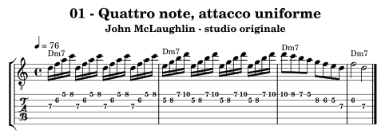
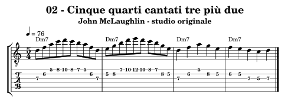
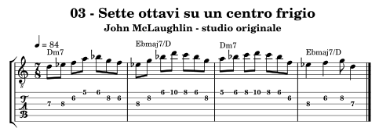
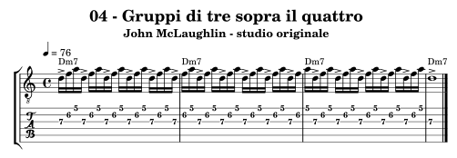
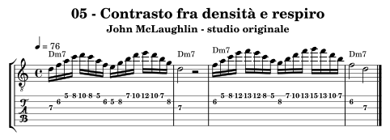
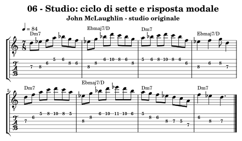

.. _autore-mclaughlin:

John McLaughlin
===============

Il percorso entra nel rapporto fra energia, precisione e organizzazione del tempo. Cellule regolari, accenti che attraversano la battuta e metri dispari richiedono prima una comprensione cantata. Il lavoro elettrico di Mahavishnu e quello acustico di Shakti aprono ascolti diversi. I raggruppamenti semplici dei nostri esercizi sono propedeutici: non sostituiscono lo studio dei sistemi ritmici indiani e non vengono presentati come tāla tradizionali.

Obiettivi e prerequisiti
------------------------

**Obiettivo:** Cellule, accenti, metri dispari e sviluppo modale.

Riprendi :doc:`Scale <../4-scale>`, :doc:`Modern jazz e fusion <../9-modern-jazz-fusion>`. Per l’analisi consulta `il percorso in Teoria <https://appunti-di-teoria-e-armonia-per-chitarra-jazz.readthedocs.io/it/latest/13-percorsi-autore.html#autore-mclaughlin>`_.

Ascolti guidati
---------------

**The Inner Mounting Flame — Mahavishnu Orchestra, con John McLaughlin**

Scegli il primo tema e separa pulsazione, accenti e disegno melodico. Cerca un punto in cui gli strumenti condividono gli attacchi e uno in cui le parti si differenziano.

**Shakti — album del gruppo con John McLaughlin**

Scegli una breve frase e segui la risposta fra chitarra e percussioni. Confronta attacco, spazio e articolazione con l’ascolto elettrico, senza presumere che la stessa griglia ritmica spieghi entrambi.

Fonti e accesso agli ascolti: `Musical Life, racconto e discografia di John McLaughlin <https://www.johnmclaughlin.com/musical-life/>`_.

Che cosa osservare
------------------

Nell’esercizio 04 tre sedicesimi si ripetono per tre battute di 4/4: 48 suddivisioni contengono sedici cellule e riportano l’accento all’inizio della misura. Il metro non cambia. Nello studio 06 cambia invece la misura: sette crome raggruppate 2+2+3. Mi♭ sopra Re rende riconoscibile il materiale frigio, distinto dal Mi naturale dorico di altri esercizi.

**Confronto:** Suona una sola altezza e confronta accenti ogni tre sedicesimi in 4/4 e una battuta di 7/8. Poi aggiungi Re–Mi♭–Fa e ascolta separatamente l’effetto del colore modale e del metro.

.. _autore-mclaughlin-01:

01 — Quattro note, attacco uniforme
-----------------------------------

**4 battute in 4/4; semiminima = 76; suddivisioni regolari.** Una sigla per battuta.

**Griglia:** ``| Dm7 | Dm7 | Dm7 | Dm7 |``.

Due cellule di sedicesimi regolari si alternano su Re dorico. La prima esplicita Dm7; la seconda presenta 9–11–13–1.

**Al lavoro:** Studia a metà velocità e ferma subito la ripetizione se la mano si irrigidisce. Cerca attacchi e durata uniformi prima di aumentare il tempo.

.. raw:: html

   <audio controls preload="none" aria-label="John McLaughlin, esempio originale 01">
     <source src="../_static/music/autori-mclaughlin-01.mp3" type="audio/mpeg">
   </audio>

.. _autore-mclaughlin-02:

02 — Cinque quarti cantati tre più due
--------------------------------------

**4 battute in 5/4; semiminima = 76; suddivisioni regolari.** Raggruppamento: 3 + 2 semiminime. Una sigla per battuta.

**Griglia:** ``| Dm7 | Dm7 | Dm7 | Dm7 |``.

Dieci crome occupano cinque quarti raggruppati 3+2. Le prime sei crome formano il primo gruppo, le ultime quattro il secondo.

**Al lavoro:** Conta UNO due tre | QUATTRO cinque e canta gli inizi dei gruppi prima di aggiungere tutte le note.

.. raw:: html

   <audio controls preload="none" aria-label="John McLaughlin, esempio originale 02">
     <source src="../_static/music/autori-mclaughlin-02.mp3" type="audio/mpeg">
   </audio>

.. _autore-mclaughlin-03:

03 — Sette ottavi su un centro frigio
-------------------------------------

**4 battute in 7/8; semiminima = 84; suddivisioni regolari.** Raggruppamento: 2 + 2 + 3 crome. Una sigla per battuta.

**Griglia:** ``| Dm7 | Ebmaj7/D | Dm7 | Ebmaj7/D |``.

Re–Mi♭–Fa–Sol–La–Si♭–Do stabilisce il materiale frigio; Mi♭ è il semitono sopra il centro Re. La griglia alterna Dm7 ed E♭maj7/D.

**Al lavoro:** Conta 2+2+3 crome e canta Re–Mi♭. Il conteggio iniziale ha sette crome; non confonderlo con sette quarti.

.. raw:: html

   <audio controls preload="none" aria-label="John McLaughlin, esempio originale 03">
     <source src="../_static/music/autori-mclaughlin-03.mp3" type="audio/mpeg">
   </audio>

.. _autore-mclaughlin-04:

04 — Gruppi di tre sopra il quattro
-----------------------------------

**4 battute in 4/4; semiminima = 76; suddivisioni regolari.** Una sigla per battuta.

**Griglia:** ``| Dm7 | Dm7 | Dm7 | Dm7 |``.

Sedici gruppi di tre sedicesimi attraversano tre battute di 4/4. Gli accenti continuano oltre la stanghetta, mentre basso e batteria mantengono il metro.

**Al lavoro:** Batti soltanto i quarti e canta la cellula. Riduci poi a una sola nota con gli accenti scritti: il ciclo deve restare comprensibile anche senza altezze.

.. raw:: html

   <audio controls preload="none" aria-label="John McLaughlin, esempio originale 04">
     <source src="../_static/music/autori-mclaughlin-04.mp3" type="audio/mpeg">
   </audio>

.. _autore-mclaughlin-05:

05 — Contrasto fra densità e respiro
------------------------------------

**4 battute in 4/4; semiminima = 76; suddivisioni regolari.** Una sigla per battuta.

**Griglia:** ``| Dm7 | Dm7 | Dm7 | Dm7 |``.

Una battuta densa trova risposta in una nota lunga e una pausa; il secondo gesto raggiunge un registro più alto e poi si posa.

**Al lavoro:** Suona la parte densa piano e la nota di arrivo più presente. La velocità ha senso se il contrasto fra le frasi rimane udibile.

.. raw:: html

   <audio controls preload="none" aria-label="John McLaughlin, esempio originale 05">
     <source src="../_static/music/autori-mclaughlin-05.mp3" type="audio/mpeg">
   </audio>

.. _autore-mclaughlin-06:

06 — Studio: ciclo di sette e risposta modale
---------------------------------------------

**8 battute in 7/8; semiminima = 84; suddivisioni regolari.** Raggruppamento: 2 + 2 + 3 crome. Una sigla per battuta.

**Griglia:** ``| Dm7 | Ebmaj7/D | Dm7 | Ebmaj7/D | Dm7 | Ebmaj7/D | Dm7 | Dm7 |``.

Otto battute in 7/8, sempre 2+2+3. Le prime quattro espongono il materiale, quinta e sesta lo spingono in alto, settima e ottava riconducono a Re. Le note rimangono nel materiale frigio.

**Al lavoro:** Esegui prima solo la prima nota dei tre gruppi. Poi suona la linea completa e inventa un nuovo finale di sette crome mantenendo la stessa forma.

.. raw:: html

   <audio controls preload="none" aria-label="John McLaughlin, esempio originale 06">
     <source src="../_static/music/autori-mclaughlin-06.mp3" type="audio/mpeg">
   </audio>

**Base senza la chitarra scritta:**

.. raw:: html

   <audio controls preload="none" aria-label="Base dello studio conclusivo, percorso John McLaughlin">
     <source src="../_static/music/autori-mclaughlin-06-base.mp3" type="audio/mpeg">
   </audio>

Autovalutazione e approfondimento
---------------------------------

Sai cantare il ciclo e riconoscere l’inizio della battuta senza la chitarra? Densità e velocità mantengono rilassatezza, pulizia e un punto di arrivo?

Alterna due battute dense e due rarefatte senza cambiare tempo. Per approfondire il rapporto con le tradizioni indiane parti dalle lezioni e collaborazioni documentate dall’artista, mantenendo distinti esercizi introduttivi e sistemi ritmici completi.

Per passare a un altro linguaggio, torna a :doc:`../10-percorsi-autore` e
scegli un percorso che cambi una sola dimensione del tuo studio attuale.
