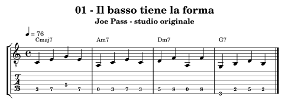
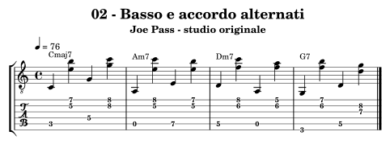
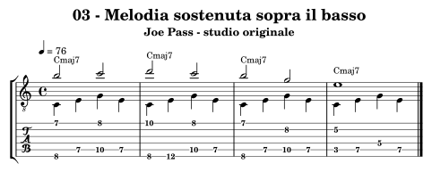
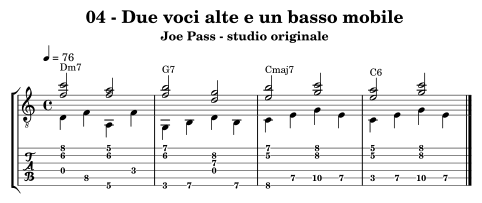
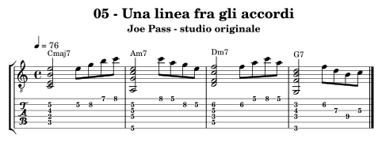
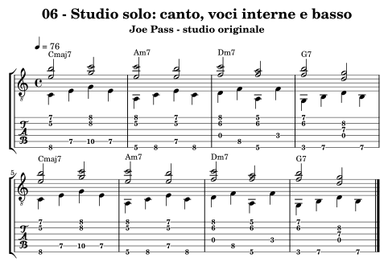

.. _autore-pass:

Joe Pass
========

Qui la chitarra assume più funzioni nello stesso tempo: suggerisce il basso, sostiene l’armonia e rende riconoscibile una melodia. Prima alterniamo i registri, poi sovrapponiamo voci con durate indipendenti. Le versioni complete sono per chitarra sola: non viene aggiunto un bassista che nasconda il compito. La semplicità del giro permette di ascoltare equilibrio e continuità.

Obiettivi e prerequisiti
------------------------

**Obiettivo:** Chitarra sola: basso, canto e voci interne.

Riprendi :doc:`Accordi <../6-accordi>`, :doc:`Progressioni <../7-progressioni>`. Per l’analisi consulta `il percorso in Teoria <https://appunti-di-teoria-e-armonia-per-chitarra-jazz.readthedocs.io/it/latest/13-percorsi-autore.html#autore-pass>`_.

Ascolti guidati
---------------

**Night and Day — Joe Pass, Virtuoso**

Ascolta prima il canto e poi i suoni bassi. Individua un passaggio in cui basso e melodia si alternano e uno in cui si sovrappongono.

**Stella by Starlight — stesso album**

Segna un punto in cui la densità si riduce e uno in cui aumenta. Conta la forma anche durante le linee a nota singola: quali arrivi fanno riconoscere gli accordi?

Fonti e accesso agli ascolti: `Virtuoso, catalogo Concord <https://concord.com/concord-albums/virtuoso-original-jazz-classics-remasters/>`_, `Joe Pass, profilo Concord <https://concord.com/artist/joe-pass/>`_.

Che cosa osservare
------------------

Nell’esercizio 04 il basso si muove in quarti, le due voci superiori in minime. Su G7 si ascoltano prima Fa–Si e poi Re–Sol; su Cmaj7 seguono Mi–Si e Sol–Do. L’armonia è resa udibile da tre linee simultanee e dal contesto. Tonica, terza e quinta occupano il basso; non sono introdotte tensioni come note più gravi.

**Confronto:** Riduci il passaggio a due voci: basso e canto. Aggiungi solo dopo la voce interna, osservando quali note possono continuare a risuonare fra due attacchi del basso.

.. _autore-pass-01:

01 — Il basso tiene la forma
----------------------------

**4 battute in 4/4; semiminima = 76; crome swing 2:1.** Una sigla per battuta.

**Griglia:** ``| Cmaj7 | Am7 | Dm7 | G7 |``.

Le fondamentali, terze e quinte descrivono il giro senza una sezione ritmica esterna. Ogni nota di basso è una nota dell’accordo.

**Al lavoro:** Conta e canta la fondamentale di ogni battuta. Suona le quattro note senza affrettare il passaggio di corda.

.. raw:: html

   <audio controls preload="none" aria-label="Joe Pass, esempio originale 01">
     <source src="../_static/music/autori-pass-01.mp3" type="audio/mpeg">
   </audio>

.. _autore-pass-02:

02 — Basso e accordo alternati
------------------------------

**4 battute in 4/4; semiminima = 76; crome swing 2:1.** Una sigla per battuta.

**Griglia:** ``| Cmaj7 | Am7 | Dm7 | G7 |``.

Il basso occupa primo e terzo movimento, le coppie superiori secondo e quarto. I registri si rispondono senza suonare tutti insieme.

**Al lavoro:** Studia le due parti separatamente, poi alternale. I suoni bassi devono essere più leggeri del canto.

.. raw:: html

   <audio controls preload="none" aria-label="Joe Pass, esempio originale 02">
     <source src="../_static/music/autori-pass-02.mp3" type="audio/mpeg">
   </audio>

.. _autore-pass-03:

03 — Melodia sostenuta sopra il basso
-------------------------------------

**4 battute in 4/4; semiminima = 76; crome swing 2:1.** Una sigla per battuta.

**Griglia:** ``| Cmaj7 | Cmaj7 | Cmaj7 | Cmaj7 |``.

La voce superiore procede per minime, con una semibreve finale e il basso continua in quarti: due durate indipendenti sulla stessa chitarra.

**Al lavoro:** Lascia risuonare le note alte mentre attacchi il basso. Le due voci del pentagramma e della TAB condividono il tempo, non la durata di ogni evento.

.. raw:: html

   <audio controls preload="none" aria-label="Joe Pass, esempio originale 03">
     <source src="../_static/music/autori-pass-03.mp3" type="audio/mpeg">
   </audio>

.. _autore-pass-04:

04 — Due voci alte e un basso mobile
------------------------------------

**4 battute in 4/4; semiminima = 76; crome swing 2:1.** Una sigla per battuta.

**Griglia:** ``| Dm7 | G7 | Cmaj7 | C6 |``.

Le coppie superiori durano due movimenti mentre il basso si muove ogni quarto. Il Fa e il Si di G7 trovano Mi e Si in Cmaj7.

**Al lavoro:** Canta il canto e suona solo il basso; poi aggiungi la voce interna. Evita che la nota di basso interrompa le due note tenute sopra.

.. raw:: html

   <audio controls preload="none" aria-label="Joe Pass, esempio originale 04">
     <source src="../_static/music/autori-pass-04.mp3" type="audio/mpeg">
   </audio>

.. _autore-pass-05:

05 — Una linea fra gli accordi
------------------------------

**4 battute in 4/4; semiminima = 76; crome swing 2:1.** Una sigla per battuta.

**Griglia:** ``| Cmaj7 | Am7 | Dm7 | G7 |``.

Ogni accordo dura due movimenti; una breve linea occupa gli altri due. È un’alternanza di tessiture, distinta dalle voci simultanee dell’esercizio precedente.

**Al lavoro:** Suona prima soltanto accordo e ultima nota della frase. Poi riempi lo spazio senza perdere i quattro movimenti.

.. raw:: html

   <audio controls preload="none" aria-label="Joe Pass, esempio originale 05">
     <source src="../_static/music/autori-pass-05.mp3" type="audio/mpeg">
   </audio>

.. _autore-pass-06:

06 — Studio solo: canto, voci interne e basso
---------------------------------------------

**8 battute in 4/4; semiminima = 76; crome swing 2:1.** Una sigla per battuta.

**Griglia:** ``| Cmaj7 | Am7 | Dm7 | G7 | Cmaj7 | Am7 | Dm7 | G7 |``.

Il basso procede in quarti con toniche, terze e quinte; le due voci superiori durano due quarti. Nessun basso o accordo viene aggiunto da un altro strumento: tutto il materiale armonico scritto appartiene alla chitarra.

**Al lavoro:** Studia basso, canto e voce interna separatamente, poi in coppie e infine insieme. La base finale contiene soltanto un riferimento ritmico: esegui tu tutte le parti.

.. raw:: html

   <audio controls preload="none" aria-label="Joe Pass, esempio originale 06">
     <source src="../_static/music/autori-pass-06.mp3" type="audio/mpeg">
   </audio>

**Riferimento ritmico per eseguire tutte le parti della chitarra:**

.. raw:: html

   <audio controls preload="none" aria-label="Base dello studio conclusivo, percorso Joe Pass">
     <source src="../_static/music/autori-pass-06-base.mp3" type="audio/mpeg">
   </audio>

Autovalutazione e approfondimento
---------------------------------

Le note alte tengono la loro durata mentre il basso continua? Il canto rimane più presente delle voci interne e la forma si riconosce senza altri strumenti?

Prepara quattro battute di una progressione con un basso semplice e una melodia cantabile. Scrivi prima le due linee separate, controlla la compatibilità delle corde, poi inserisci soltanto le voci interne indispensabili.

Per passare a un altro linguaggio, torna a :doc:`../10-percorsi-autore` e
scegli un percorso che cambi una sola dimensione del tuo studio attuale.
