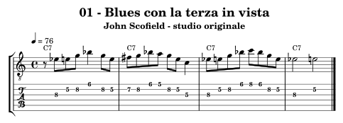
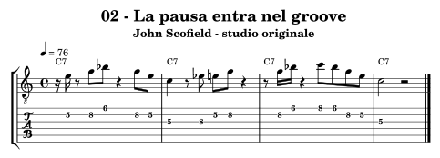
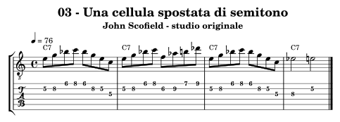
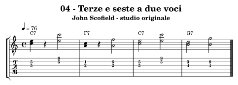
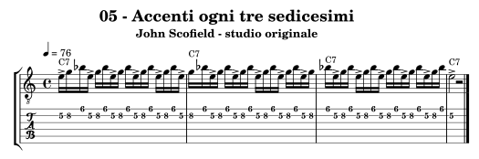
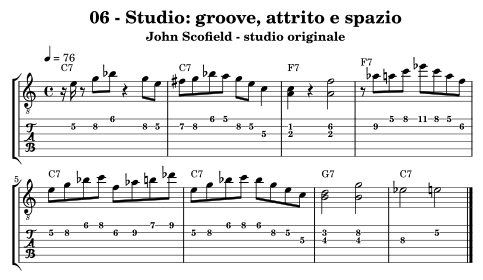

.. _autore-scofield:

John Scofield
=============

Il percorso mette in relazione il carattere blues con una griglia ritmica precisa. Pause, attacchi spostati e doppie note possono contare più di una scala nuova; brevi spostamenti cromatici diventano chiari quando il rientro conserva il groove. Il timbro e le inflessioni fanno parte dell’ascolto: l’audio sintetico degli esercizi verifica ritmo e altezze e non riproduce quelle sfumature.

Obiettivi e prerequisiti
------------------------

**Obiettivo:** Blues, groove, doppie note e tensione con rientro.

Riprendi :doc:`Progressioni <../7-progressioni>`, :doc:`Licks <../8-licks>`, :doc:`Modern jazz e fusion <../9-modern-jazz-fusion>`. Per l’analisi consulta `il percorso in Teoria <https://appunti-di-teoria-e-armonia-per-chitarra-jazz.readthedocs.io/it/latest/13-percorsi-autore.html#autore-scofield>`_.

Ascolti guidati
---------------

**Do Like Eddie — John Scofield, Hand Jive**

Segui cassa e basso prima della chitarra. Segna una pausa della linea e prova a cantare dove rientra rispetto al groove.

**Dark Blue — stesso album**

Individua un gesto blues e una risposta più dissonante. Confronta durata della tensione e chiarezza del punto d’arrivo senza attribuire una scala a ogni singola nota.

Fonti e accesso agli ascolti: `Hand Jive, Blue Note: tracce e organico <https://store.bluenote.com/products/john-scofield-hand-jive-2lp-blue-note-classic-vinyl-edition>`_, `John Scofield, biografia ufficiale <https://www.johnscofield.com/bio/>`_.

Che cosa osservare
------------------

Nell’esercizio 03 Mi–Sol–Si♭–Do su C7 diventa Fa–La♭–Si–Re♭ per mezza battuta e ritorna. Fa resta nel contesto mixolidio, le altre tre note producono attriti più marcati. Il side-slip dipende dal parallelismo riconoscibile e dal rientro sul Mi, non dal fatto che tutte le note siano esterne.

**Confronto:** Suona la stessa uscita con ritmo continuo e poi separata da una pausa; confronta quanto è percepibile il collegamento. Riduci a una nota il ritmo sincopato dell’esercizio 02 e verifica se resta un groove.

.. _autore-scofield-01:

01 — Blues con la terza in vista
--------------------------------

**4 battute in 4/4; semiminima = 76; suddivisioni regolari.** Una sigla per battuta.

**Griglia:** ``| C7 | C7 | C7 | C7 |``.

Mi♭–Mi porta la frizione blues dentro C7; Fa♯ passa a Sol. Il finale conserva la distanza fra terza blues e terza maggiore.

**Al lavoro:** Canta il Mi♭ finale e ascolta il Mi nell’accordo, poi suona il Mi scritto. Cerca un attacco espressivo senza cambiare le altezze di riferimento.

.. raw:: html

   <audio controls preload="none" aria-label="John Scofield, esempio originale 01">
     <source src="../_static/music/autori-scofield-01.mp3" type="audio/mpeg">
   </audio>

.. _autore-scofield-02:

02 — La pausa entra nel groove
------------------------------

**4 battute in 4/4; semiminima = 76; suddivisioni regolari.** Una sigla per battuta.

**Griglia:** ``| C7 | C7 | C7 | C7 |``.

Gli attacchi lasciano vuoti dentro la griglia di sedicesimi. Il basso e la batteria continuano mentre la chitarra tace.

**Al lavoro:** Suona inizialmente una sola nota con il ritmo scritto. Aggiungi le altezze soltanto quando le pause rimangono precise.

.. raw:: html

   <audio controls preload="none" aria-label="John Scofield, esempio originale 02">
     <source src="../_static/music/autori-scofield-02.mp3" type="audio/mpeg">
   </audio>

.. _autore-scofield-03:

03 — Una cellula spostata di semitono
-------------------------------------

**4 battute in 4/4; semiminima = 76; suddivisioni regolari.** Una sigla per battuta.

**Griglia:** ``| C7 | C7 | C7 | C7 |``.

Mi–Sol–Si♭–Do viene spostato a Fa–La♭–Si–Re♭ nella seconda metà della seconda battuta, poi torna al disegno iniziale. Fa rimane interno al contesto; La♭, Si e Re♭ rendono evidente l’uscita.

**Al lavoro:** Canta il rientro sul Mi della terza battuta e tieni il piede sui quarti durante il passaggio esterno.

.. raw:: html

   <audio controls preload="none" aria-label="John Scofield, esempio originale 03">
     <source src="../_static/music/autori-scofield-03.mp3" type="audio/mpeg">
   </audio>

.. _autore-scofield-04:

04 — Terze e seste a due voci
-----------------------------

**4 battute in 4/4; semiminima = 76; suddivisioni regolari.** Una sigla per battuta.

**Griglia:** ``| C7 | F7 | C7 | G7 |``.

Do–Mi e Mi–Do su C7; La–Do e La–Fa su F7; Si–Re e Si–Sol su G7. Le prime coppie sono terze, le seconde seste: note dell’accordo distribuite in due registri diversi.

**Al lavoro:** Suona prima la voce superiore con il ritmo scritto. Aggiungi l’altra voce senza irrigidire l’attacco. Sono coppie melodiche, non voicing completi con tensioni al basso.

.. raw:: html

   <audio controls preload="none" aria-label="John Scofield, esempio originale 04">
     <source src="../_static/music/autori-scofield-04.mp3" type="audio/mpeg">
   </audio>

.. _autore-scofield-05:

05 — Accenti ogni tre sedicesimi
--------------------------------

**4 battute in 4/4; semiminima = 76; suddivisioni regolari.** Una sigla per battuta.

**Griglia:** ``| C7 | C7 | C7 | C7 |``.

La cellula Mi–Sol–Si♭ ripete un accento ogni tre sedicesimi per tre battute; la batteria conserva il 4/4. Dopo 48 sedicesimi, sedici cellule tornano all’inizio della misura.

**Al lavoro:** Canta soltanto gli accenti e batti i quarti. Poi aggiungi le note deboli più piano e rispetta il riposo finale.

.. raw:: html

   <audio controls preload="none" aria-label="John Scofield, esempio originale 05">
     <source src="../_static/music/autori-scofield-05.mp3" type="audio/mpeg">
   </audio>

.. _autore-scofield-06:

06 — Studio: groove, attrito e spazio
-------------------------------------

**8 battute in 4/4; semiminima = 76; suddivisioni regolari.** Una sigla per battuta.

**Griglia:** ``| C7 | C7 | F7 | F7 | C7 | C7 | G7 | C7 |``.

Una forma di otto battute combina pause, doppie note, terza blues e un’uscita di semitono. Nella sesta battuta il ritorno al Mi chiarisce il rientro su C7.

**Al lavoro:** Sulla base mantieni i vuoti della prima battuta e il rientro della sesta. Cambia l’uscita senza aumentare il numero totale degli attacchi.

.. raw:: html

   <audio controls preload="none" aria-label="John Scofield, esempio originale 06">
     <source src="../_static/music/autori-scofield-06.mp3" type="audio/mpeg">
   </audio>

**Base senza la chitarra scritta:**

.. raw:: html

   <audio controls preload="none" aria-label="Base dello studio conclusivo, percorso John Scofield">
     <source src="../_static/music/autori-scofield-06-base.mp3" type="audio/mpeg">
   </audio>

Autovalutazione e approfondimento
---------------------------------

Sai mantenere la suddivisione nelle pause e cantare il rientro prima dell’uscita? Le doppie note sostengono la frase senza coprire l’accompagnamento?

Costruisci otto battute con una sola uscita e almeno due pause lunghe. Sul secondo giro conserva gli stessi punti di rientro ma cambia l’articolazione: registra e confronta.

Per passare a un altro linguaggio, torna a :doc:`../10-percorsi-autore` e
scegli un percorso che cambi una sola dimensione del tuo studio attuale.
